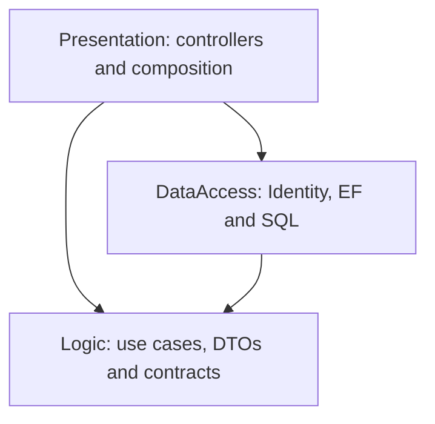

# MyBasisWebApi — Technical Design Document

Revision: 0.1.0.0 | Date: 2026-11-18 | Status: DRAFT design, not implemented

## Scope and source

Implement [SRS.md](SRS.md) within [DECISIONS.md](DECISIONS.md). The existing product remains the code at the baseline recorded in [STATUS.md](STATUS.md). This foundation changes project documentation and plugin instructions only.

## Runtime and dependency baseline

Target `net11.0`, stable SDK 11.0.100 and the compatible .NET/ASP.NET Core/EF Core/Identity/JWT 11.0.0 generation as verified on 2026-11-18. Use SDK default C# 15 rather than preview language features. Recheck current stable patches when implementation starts. `global.json` should state an intentional stable roll-forward policy and `allowPrerelease: false`; it has not yet been added.

Check the complete restore graph, not just major version labels. EF Core tooling requires an explicit development-only `Microsoft.EntityFrameworkCore.Design` reference in EF11. Review EF10 and EF11 breaking changes because the source starts on EF9. Verify SQL Server compatibility level; do not silently assume an older database supports EF11's new default of 160.

The existing packages contain MediatR 14 and AutoMapper 13; tests also have AutoMapper 14. Current MediatR 15 / AutoMapper 17 introduce compatibility and licence questions. DEC-005 proposes ordinary services and explicit mapping for the reusable core. Do not install a commercial entitlement, silence licence warnings, use an old version solely to evade licensing, or claim all downstream customers qualify for a community licence.

Replace the unsupported `FluentValidation.AspNetCore` integration with the supported core and DI packages when the validation task is implemented. Invoke validation asynchronously for actual request objects. Consider the built-in ASP.NET Core rate limiter and built-in OpenAPI generation to reduce dependencies; choose and verify a compatible documentation UI separately. OData is optional unless a real query contract needs it. Keep Testcontainers in test projects only when real-container testing is actually selected and available.

## Architecture

Retain the three active projects during the initial build/security work. Proposed target dependencies:

The host assembles DI and cross-cutting middleware. Controllers translate transport to use cases. Logic holds use-case contracts/validation and avoids EF DbContext and ASP.NET Identity concrete dependencies. DataAccess implements user/session/role persistence through the actual abstractions needed by these flows. Do not add a generic repository, a universal mediator replacement or an interface for every class.

The current graph is Presentation → Logic → DataAccess. Change it deliberately in TASK-10 after behavior is protected. The existing Domain project is disconnected from the three-project solution; inspect real references before retaining or removing it. File moves must preserve namespaces, migrations and accessible public contracts or document a deliberate breaking change.

## HTTP contract

Preserve current routes during initial hardening: `POST /api/account/register`, `/api/account/login`, `/api/account/refreshtoken`, and role actions under `/api/roles`. Existing DTO field names are the migration baseline, not a reason to keep an insecure requirement. If refresh drops the old access JWT/userId input, document that change and add compatibility only if an actual consumer requires it.

Add one real, useful protected self-read endpoint for the vertical-flow acceptance when needed; do not add a fake `/api/test` business response to satisfy the old test. Define its minimal DTO and access contract in the implementation task. Keep route/API version separate from the four-part product build version.

Use `[ApiController]`, explicit action binding and request DTO validation. Apply authenticated-by-default policy or equivalent explicit coverage, and mark only reviewed public account operations anonymous. Role actions require the administrative policy. No query-string/cookie JWT transport in the core.

Centralize errors using ProblemDetails; preserve 401/403 semantics and avoid turning expected input failures into 500s. Include a correlation identifier safe for the caller. Authentication and role responses carry `Cache-Control: no-store`; public caching is opt-in on an identified public GET contract only.

## Authentication, sessions and roles

Use ASP.NET Core Identity hashing and validation. Token generation and validation share validated configuration and an explicitly permitted signing algorithm. Never rely on `ReadJwtToken` as authentication. Keep secrets outside tracked settings; prohibit known example signing keys in normal operation.

Design refresh around a cryptographically random bearer secret whose hash is stored in SQL. Persist user/session family, expiry and consumption/revocation state. Use an atomic compare-and-consume transaction/concurrency constraint when creating the successor. Two concurrent requests cannot both consume the same token. Store only the material needed for audit; avoid raw tokens and full credentials in logs. Resolve lifetime/session/revocation policy before implementing this table.

Validate identity binding before any security-stamp or token-family mutation. A random invalid request cannot revoke another user's sessions. Verified replay handling affects only the documented session family and records its reason. A failed or unknown transaction is not automatically replayed as a new login/refresh.

Administrative authorization must account for the chosen revocation semantics. A stale JWT role claim alone cannot satisfy an advertised immediate-revocation guarantee. Enforce the last-administrator invariant transactionally if concurrent role removal is possible. Provision the first administrator through an explicitly selected operator procedure; never seed a public password or promote the first registered user automatically.

## Configuration, data and operations

Use one validated JWT lifetime option (`ExpiryMinutes` is the current typed property); migrate or reject the legacy `DurationInMinutes` development key instead of silently ignoring it. Preserve the current ten-minute value until a deliberate decision changes it. Use environment/user-secret injection for credentials. CORS lists explicit origins and does not require `AllowCredentials` solely to accept an Authorization header.

Keep trusted forwarded-header/proxy configuration explicit before using forwarded client addresses for rate limits. No universal proxy trust is enabled by the template. Provide a bounded auth-specific limiter and a general policy; observe 429 behavior without logging credentials.

Configure `ILogger<T>` centrally through Serilog with a persistent rolling sink and practical retention. Verify sink access and redaction in the first real run. Distinguish `/health/live` process health from `/health/ready` dependency readiness if these routes are adopted; expose no privileged details. No actual host, public ingress, TLS certificate, deployment or external log service is provisioned here.

## Reuse and packaging

After the secured vertical flow passes, and only if DEC-011 is accepted, build a local `dotnet new` package with deliberate `sourceName`, template identity, safe output/exclusions and a small set of useful parameters. A generated API must receive its own names, user-secret identity, configuration and version context. It must not inherit tokens, local settings, logs, compiled output, this project's plugin or dated maintenance state.

Generate at least two differently named projects into empty directories to check rename completeness and collisions. Restore/build and run the real configured smoke flow on a generated instance; the checked-in template working is not proof that generated output works. Do not publish a NuGet package or toggle repository settings merely because packaging passes.

## Optional OpenAI adapter

Disposition: later. A separate opt-in text-to-DTO module using the official .NET SDK, Responses and Structured Outputs is a reasonable candidate. Core auth/database operation remains independent of that SDK, a key and paid access. A schema-conforming output remains an untrusted proposal subject to domain validation and authorization. Handle refusal, incomplete output, timeout, cancellation and provider errors explicitly; bound retries/spend and keep secrets server-side.

Do not add managed agents, automatic tools for role changes, Evals/Agent Builder dependencies or an always-running job to this core. See [SOURCES.md](SOURCES.md) for the dated assessment; selecting a provider requires the actual future project's data/access/budget contract.

## Delivery and verification

Follow [BACKLOG.md](BACKLOG.md) one task at a time. Keep existing useful tests and repair their project references. Add narrow tests for authorization/cache/validation/refresh defects; do not fabricate a test count with empty assertions or introduce a broad test platform before a real flow exists.

Authorized repo changes are complete only when committed, pushed to their approved ref and verified against the full remote SHA. Meaningful intermediate checkpoints are required for a long task. Inspect actual workflow/review effects before the triggering push or PR operation; online Copilot review remains separately authorized. A pending optional review is not invented when none was requested.

Release evidence must trace source SHA → product version → build/run → artifact digest → actual installation, where an installation is in scope. No product release, deployment, rollback rehearsal or full runtime acceptance has occurred in the documentation phase.
